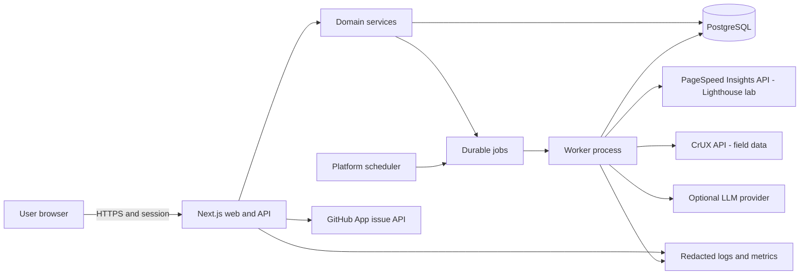

# Architecture

**Status:** Recommended architecture; implementation covers Phases 0–6. The repository began as planning docs only, with no Git metadata or existing application/deployment setup.

## Recommendation

Use one modular **Next.js + React + TypeScript** codebase for UI, authenticated server routes, domain services, and provider adapters. Use **PostgreSQL** as system of record. Run distinct worker and scheduler entrypoints from the same repository/revision as long-lived processes. Durable jobs use leases, attempts, due times, and idempotency keys. The scheduler uses row locks and per-organization active-job caps to dispatch recurring work without another queue dependency.

Do not run long audits inline in serverless requests. Select a host that supports web, worker, and scheduler processes or a managed queue/worker alternative. Add a broker only when measured queue load justifies it.

## Stack and component responsibilities

- **Web/UI:** Next.js, React, strict TypeScript; responsive accessible flows; no provider secrets in browser.
- **Auth/API:** server-side sessions, tenant-scoped authorization, input schemas, CSRF/rate limiting, pagination, idempotency.
- **Domain:** URL rules, audit orchestration, normalization, compatible comparison rules, deterministic regressions, evidence validation.
- **Adapters:** PSI, CrUX, LLM, GitHub clients with fixed HTTPS hosts, timeouts, bounded retries, typed errors and redaction.
- **Persistence:** managed PostgreSQL, migrations, tenant-owned entities, normalized observations, compact evidence, jobs and outcomes.
- **Worker/scheduler:** leased jobs, bounded concurrency/quotas, retry/terminal status, due-work enqueue, safe duplicate invocation.
- **Observability:** redacted structured logs, queue/provider metrics, health/readiness checks.
- **Charts/tests:** choose accessible maintained React chart library and typed unit/integration/E2E tooling in Phase 0.

Authentication uses Auth.js with Google as the primary OAuth identity provider and GitHub as an optional alternative for existing accounts, backed by a server-side JWT session. The provider subject maps to an application user and personal workspace. Provider identities are not automatically linked. GitHub login is not the GitHub issue authorization grant. Use a separate GitHub App for repository-scoped issue creation, with credentials encrypted at rest. Keep LLM provider configurable and initially optional.

## System architecture

## Main flows

### Manual audit

1. Authenticated user submits URL and device strategy. Server validates/canonicalizes HTTPS, checks tenant quota/deduplication, and stores an audit plus idempotent job.
2. UI receives run ID/status and polls bounded status endpoint (SSE only if host supports it cleanly).
3. Worker leases job, requests PSI for the selected device and categories, stores normalized category scores/metrics/evidence/version/time and compact context.
4. Worker queries dedicated CrUX for page-level `PHONE`/`DESKTOP`; optional origin lookup is a separate scope. Store p75/histogram and 28-day collection dates when present.
5. Worker marks succeeded/partial/failed; compares only compatible values; records deterministic regression events; releases the lease.

### Dashboard and AI

Dashboard endpoints verify tenant scope, return bounded summaries/time series, and never deliver all raw audit blobs. Lab and field data remain separate. Optional AI receives compact allowlisted evidence IDs and changes only an explanation record; server validates every evidence reference and exposes unavailable/invalid status without blocking core use.

### GitHub

User selects an authorized App installation/repository, edits a draft, reviews evidence and dashboard link, and explicitly confirms. Server rechecks membership/authorization, CSRF and idempotency before issue creation. Store outcome and issue URL/number; never plaintext credentials.

## Background processing

PSI can take tens of seconds; older official notes cite a maximum request timeout up to 120 seconds, so current provider and host limits must be rechecked. Handlers enqueue and return promptly. PostgreSQL rows track state, `available_at`, attempts, lease owner/until, and idempotency. Workers claim batches transactionally (e.g. `FOR UPDATE SKIP LOCKED`), bound concurrency, and recover expired leases. Separate PSI/CrUX limiters; current CrUX docs specify 150 requests/minute/project. Schedule enqueues are idempotent and capped per tenant/global project.

## Deployment

Local model: Node.js web + worker processes and PostgreSQL 17 via `compose.yaml`. Production model: one container-capable host, web service and worker service from the same image/revision, managed PostgreSQL, managed secret storage, and a scheduler/cron trigger. Worker has no public ingress. Vendor remains undecided; verify execution limits, worker/scheduler capability, DB pooling, secret management, backups/restore, data region and cost before public deployment. CI builds once; migrations are a reviewed release step; deploy web/worker and check health/readiness.

## Alternatives and trade-offs

| Option | Assessment |
|---|---|
| Next.js + same-repo worker (recommended) | One language, fewer deployments, shared types. Requires a worker-capable host. |
| Next.js + FastAPI | Useful for Python-specific pipelines/team expertise, but duplicates contracts/auth and increases operations without present need. |
| Serverless-only | Easy web deploy, but long audits and recurring durable work exceed common request lifetimes unless paired with managed queue/worker. |
| PostgreSQL queue vs Redis/broker | Postgres is adequate for early load and transactional state; reassess queue contention/throughput metrics before adding infrastructure. |
| PSI embedded CrUX vs dedicated CrUX | Dedicated CrUX is recommended because PSI docs say embedded field data is planned for removal; a separate adapter clarifies provenance. |
| GitHub PAT vs App | App grants can be repository-scoped/revocable and minimal, with more onboarding work. |

See `docs/DECISIONS.md` and `docs/API_AND_INTEGRATIONS.md` for ADRs and external references.
