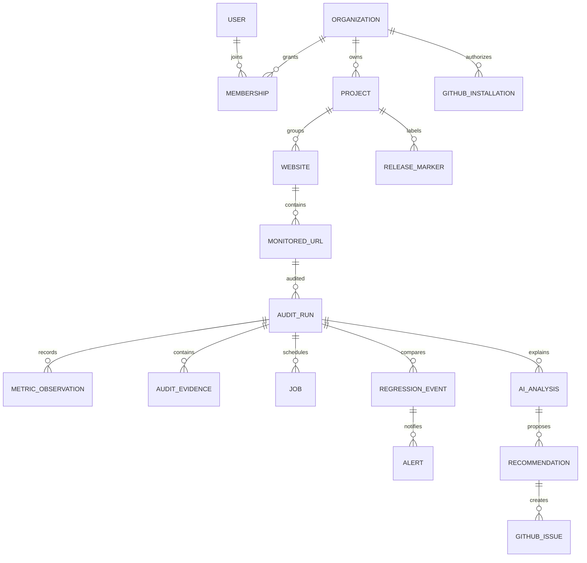

# Proposed data model

**Implementation status:** Migrations 001–011 are present. User/workspace, project, monitored URL, durable audit/job, field data, normalized observations, regression policy/event, in-app alert, audit schedule, release marker/association, regression analysis, encrypted GitHub connection/state, GitHub issue outcome, tenant rate limits, and expiring guest audit access are implemented.

**Implementation note:** Migrations define users, workspaces, projects, monitored URLs, audit runs/jobs, CrUX snapshots, normalized metric observations, regression policies/events, in-app alerts, schedules, manual release associations, structured regression analyses, temporary OAuth state, encrypted GitHub user authorization, issue outcomes, and rate-limit buckets. Query layer uses PostgreSQL directly.

## Entity relationships

## Core entities

- **User:** identity-provider subject and minimal display metadata; no provider login secrets.
- **Organization:** tenant, name, plan/usage caps, timestamps. A personal workspace can be an organization with owner membership.
- **Membership:** organization/user, role (`owner`, `admin`, `member`, optionally `viewer`), invitation state; unique `(organization_id,user_id)`.
- **Project:** organization, name, preferences, archive timestamps.
- **Website:** project, canonical origin, optional name; unique origin per project.
- **MonitoredUrl:** website, normalized URL, label, enabled/frequency, validation state; unique normalized URL per website. Strip userinfo and sensitive query parameters.
- **AuditRun:** URL, requested strategy, status (`queued`, `running`, `succeeded`, `partial`, `failed`, `cancelled`), request source, idempotency key, request/start/complete times, requested/final URL, Lighthouse/PSI version, warnings/error code, evidence reference/hash, retention timestamps, optional manual release association.
- **MetricObservation:** run, metric key, numeric value only when present, unit, source (`lighthouse_lab`, `crux_field`), form factor, scope (`page`, `origin`), aggregation (`single_run`, `p75`), collection dates, provider key, observed time, explicit availability reason. Unique by run/metric/source/form factor/scope/aggregation.
- **AuditEvidence:** run, stable Lighthouse audit ID, title, score/null, display mode, bounded description/details, savings and checksum. Store relevant findings, not every large payload by default.
- **Job:** tenant/project, type, related entity, status, `available_at`, attempts, lease owner/until, idempotency key, error class, timestamps.
- **RegressionPolicy:** project/URL metric scope, source/form factor/scope, absolute/relative threshold, severity, version/enabled.
- **RegressionEvent:** tenant/project/URL, metric dimensions, before/after observation IDs and values, deltas, policy version, severity, detected/status/ack/resolved timestamps, dedupe fingerprint.
- **Alert:** regression event, tenant/user/project audience, in-app status/read time and created timestamp.
- **AIAnalysis:** run/comparison IDs, provider/model/schema version, status, evidence IDs/hash, validated JSON output, failure class, timestamps.
- **Recommendation:** analysis, stable ID, title/summary/priority/expected impact/uncertainty and verified evidence references.
- **GitHubInstallation:** tenant, installation ID, encrypted credential reference/ciphertext and key version, authorized repository cache, connected-by/status/revoked time.
- **GitHubIssue:** recommendation, installation/repository IDs, issue URL/number, idempotency key, submitter, submitted title/body snapshot, status/result/timestamps. No token or unnecessary response headers.
- **GuestAuditAccess:** one-time audit, owning anonymous organization, SHA-256 digest of a random bearer token, and 24-hour expiry. The raw token is returned once and held in browser memory only.
- **PublicAuditRateLimit:** hourly count keyed by a SHA-256 client fingerprint; raw client IP is not stored. Guest organizations and their audit data are deleted when a later guest submission performs expiry cleanup.
- **ReleaseMarker:** project, label, optional commit SHA/environment/deployment URL/time/creator, association method (`manual` initially). Temporal grouping is not proof of causality.

## Integrity, indexes, and access

- Scope every tenant-owned query through organization/project and verify server-side authorization. Database RLS may add defense in depth only after pooled-connection context is reviewed.
- Index project history `(project_id, created_at desc)`, URL audit history `(monitored_url_id, completed_at desc)`, metric series `(metric_key, source, form_factor, observed_at)`, pending jobs `(status, available_at)`, expired leases `(lease_until)`, and unread alerts by user/project.
- Add unique constraints for canonical URLs, idempotency keys, schedule due slots, and active regression fingerprints.
- Soft-delete/archive monitored entities or apply explicit retention cleanup; do not cascade away useful audit history unexpectedly.
- Keep metric value separate from availability; never use zero as missing sentinel. Keep field collection window separate from request/snapshot time.
- Compatible baselines require URL, source, device, page/origin scope, aggregation semantics, and applicable lab context to match.

## Queries and retention

- Dashboard APIs accept bounded date ranges and cursors/limits; return summary aggregates or downsampled points, never all raw payloads.
- Retain compact normalized observations/evidence longer than raw provider JSON. Define configurable raw payload retention, deletion/export, and backup policy before public release.
- CrUX consecutive-day records can have highly overlapping 28-day windows; label windows and avoid implying independent samples. Do not merge page and origin records.
- User-triggered AI sends only bounded metadata; do not retain full page HTML (the app should not fetch/store it).
